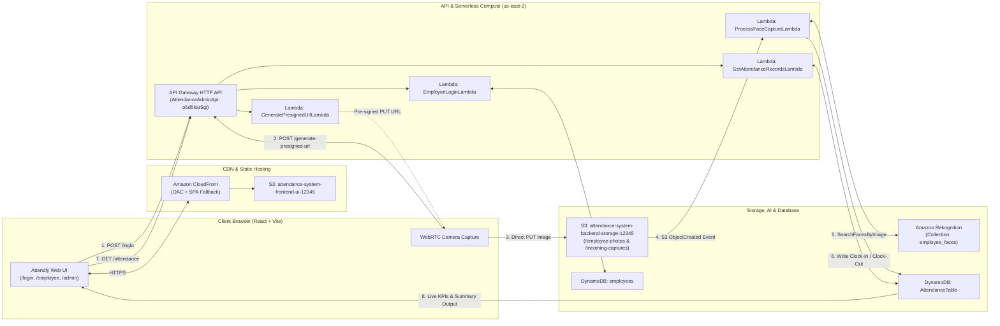

# Technical Design Document: Serverless Facial Recognition Attendance System

## 1. System Overview
Attendly is a serverless employee attendance platform deployed in AWS `us-east-2` (Ohio). Employees authenticate with their corporate email and record attendance via browser webcam capture. Captured images upload directly to Amazon S3 using short-lived pre-signed URLs, triggering an event-driven AWS Lambda pipeline that compares the capture against a pre-indexed Amazon Rekognition collection (`employee_faces`). Verified check-ins and check-outs (`OnTime` / `Present`, `Late`, `Absent`) are persisted in Amazon DynamoDB and surfaced in real time on a React/Vite web application delivered over Amazon CloudFront.

---

## 2. End-to-End Architecture & Data Flow

### Request & Event Flow
1. **Role-Based Authentication (`POST /login`):** `EmployeeLoginLambda` verifies `employee_email` against the `employees` table (and optional Cognito User Pool) and routes HR/Managers (`HR001`, `MGR001`) to `/admin` and staff (`EMP001`–`EMP004`) to `/employee`[cite: 2, 3, 4].
2. **Pre-Signed URL Issuance (`POST /generate-presigned-url`):** `GeneratePresignedUrlLambda` returns a scoped, time-limited S3 `PUT` URL targeting `incoming-captures/<timestamp>.jpg`.
3. **Direct Browser-to-S3 Upload:** The browser uploads the webcam capture directly to `attendance-system-backend-storage-12345` over HTTPS via CORS-authorized `PUT`[cite: 6].
4. **Biometric Verification (`ProcessFaceCaptureLambda`):** S3 `ObjectCreated` events trigger `ProcessFaceCaptureLambda`, which calls `rekognition:SearchFacesByImage` against `employee_faces` (indexed from `employee-photos/` using `register_employee.py`)[cite: 5].
5. **Attendance Persistence (`AttendanceTable`):** On a high-confidence match ($\ge 99\%$), the Lambda creates or updates the daily record (`clock_in`, `clock_out`, `status`, `last_capture_key`) in `AttendanceTable`[cite: 7, 9].
6. **Live Reporting (`GET /attendance`):** React dashboards fetch live DynamoDB records to render Workforce Overview KPIs, 7-day attendance trends, Employee Directory status badges, and filterable Attendance Records[cite: 2, 8, 9].

---

## 3. AWS Components & Configuration

| Component | AWS Service | Resource Name & Configuration (`us-east-2`) |
| :--- | :--- | :--- |
| **CDN & Hosting** | CloudFront + S3 | `Attendance-Frontend-CDN` $\rightarrow$ `attendance-system-frontend-ui-12345` (OAC enabled, `index.html` root object, `403`/`404` $\rightarrow$ `/index.html` HTTP `200`) |
| **API Gateway** | HTTP API (v2) | `AttendanceAdminApi` (`o5d5kar5gl`), CORS enabled for CloudFront domain |
| **Compute** | AWS Lambda (Python 3.12) | `EmployeeLoginLambda`, `GeneratePresignedUrlLambda`, `ProcessFaceCaptureLambda`, `GetAttendanceRecordsLambda` |
| **Facial Recognition** | Amazon Rekognition | Collection `employee_faces` (`ExternalImageId` mapped to `employee_id`)[cite: 5] |
| **Object Storage** | Amazon S3 | `attendance-system-backend-storage-12345` (`employee-photos/` reference portraits, `incoming-captures/` transient captures)[cite: 5, 7] |
| **NoSQL Database** | Amazon DynamoDB | `employees` (employee directory) & `AttendanceTable` (daily attendance logs)[cite: 3, 7] |

---

## 4. DynamoDB Key Schema

### `AttendanceTable`
* **Partition Key (PK):** `employee_id` (`String`) — e.g., `EMP001`, `EMP002`[cite: 7, 9]
* **Sort Key (SK):** `date` (`String`, `YYYY-MM-DD`) — e.g., `2026-11-17`
* **Attributes:** `clock_in` (`String`), `clock_out` (`String`), `status` (`String`: `present` / `OnTime` / `Late` / `absent`), `last_capture_key` (`String`), `notes` (`String`)[cite: 7, 9]
* **Billing Mode:** On-Demand (`PAY_PER_REQUEST`)

### `employees`
* **Partition Key (PK):** `employee_id` (`String`) — e.g., `EMP001`, `EMP002`, `EMP003`, `EMP004`, `MGR001`, `HR001`[cite: 3, 5]
* **Attributes:** `employee_name` (`String`), `employee_email` (`String`), `department` (`String`), `designation` (`String`), `role` (`String`), `cognito_sub` (`String`)[cite: 3]
* **Billing Mode:** On-Demand (`PAY_PER_REQUEST`)

---

## 5. IAM Permissions, Encryption & S3 Lifecycle

### IAM Least-Privilege Policy (Lambda Execution Role)
* **DynamoDB:** `dynamodb:GetItem`, `dynamodb:PutItem`, `dynamodb:UpdateItem`, `dynamodb:Query`, `dynamodb:Scan` restricted to `AttendanceTable` and `employees` ARNs[cite: 3, 7].
* **S3:** `s3:GetObject`, `s3:PutObject` restricted to `arn:aws:s3:::attendance-system-backend-storage-12345/*`[cite: 5].
* **Rekognition:** `rekognition:SearchFacesByImage`, `rekognition:IndexFaces`, `rekognition:ListCollections` restricted to `arn:aws:rekognition:us-east-2:*:collection/employee_faces`[cite: 5].
* **CloudWatch:** `logs:CreateLogGroup`, `logs:CreateLogStream`, `logs:PutLogEvents`.

### Encryption, Versioning & Lifecycle
* **Encryption at Rest & Transit:** SSE-S3 (`AES-256`) enabled on both S3 buckets; DynamoDB encrypted at rest with AWS-owned KMS keys; TLS 1.2+ enforced across CloudFront, API Gateway, and S3 pre-signed URLs.
* **Public Access:** **Block All Public Access** enabled on both S3 buckets; frontend served strictly through CloudFront OAC.
* **Versioning:** Enabled on `attendance-system-frontend-ui-12345` for static asset rollback; disabled on `incoming-captures/` to ensure hard deletion of biometric frames.
* **S3 Lifecycle Rule (`attendance-system-backend-storage-12345`):** Objects under `incoming-captures/` automatically expire and permanently delete after **1 day** (24 hours) for biometric data minimization; `employee-photos/` objects persist for active staff[cite: 5].
